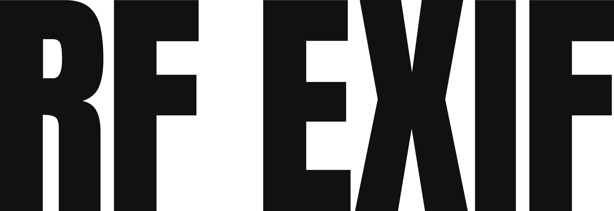

<div align="center">
  
  <h1>RF EXIF</h1>
  <p><strong>Free camera and lens insights for Canon EOS R — 100% local.</strong><br />
  Drop a CR3, JPG, or HIF. No uploads, no accounts, originals never modified.</p>

[](LICENSE)
[](https://github.com/souravrax/RFExif/actions/workflows/ci.yml)
[](https://github.com/souravrax/RFExif/actions/workflows/pages.yml)
[](https://github.com/souravrax/RFExif/releases)
</div>

- **Web app (no install):** https://souravrax.github.io/RFExif/
- **Desktop app (Windows):** [Releases](https://github.com/souravrax/RFExif/releases) — NSIS + MSI installers, USB PTP shutter-counter reader (no photo files involved)

## Why RF EXIF

Most shutter-count tools either upload your photos, paywall your own data, or
simply don't support your body. Canon's **EOS R10** (like the R7 / RP) publishes
no EXIF shutter count at all — ExifTool reports `CanonCameraInfoUnknown` and
stops there.

RF EXIF reverse-engineered it: the 4608-byte `CanonCameraInfo` blob (TIFF
tag `0x000D`, magic `BB CC 00 00`) holds a little-endian uint32 total-actuation
counter at byte **`0xC93` (3219)** — proven across 14 consecutive shots
(`22146 → 22165`): +1 per saved frame, zero skips, CR3 == JPG of the same
shot, incrementing on mechanical **and** electronic shutter. Details and full
evidence table: [`web/cameras/canon-r10/README.md`](web/cameras/canon-r10/README.md).

## Features

- 📸 **Web drag-and-drop reading** — CR3, JPG, HIF; single files or batches
- 🔌 **Desktop USB reading** — connect the camera, read the counter straight from the body over USB PTP; no files, no EXIF
- 🔒 **Private by design** — desktop and web parse everything on-device
- 📷 **Multi-camera SDK** — one declarative folder per body (`camera.toml` +
  vectors + docs), shared by web and desktop; see [Adding your camera](#adding-your-camera)
- 🧪 **Honest counters** — reverse-engineered offsets carry an *experimental*
  badge until USB-confirmed; file numbers are labeled as file numbers, never
  as shutter counts
- 📊 **Health context** — % of rated shutter life per body where known

## Supported cameras

| Body | Strategies | Web | Desktop | USB-confirmed | Rated |
|---|---|---|---|---|---|
| Canon EOS R10 | `blob-scan` | ✅ | 🔌 soon¹ | experimental | 100,000 |
| Native EXIF fallback | `exif-tag` | ✅² | — | yes | — |

¹ Desktop is USB-only (foundation in place, mock transport in dev builds) —
real PTP transports land per body next; file-based counters stay web-only.
² Web resolves native tags once a fuller EXIF backend is present; bodies
without a researched manifest resolve through the generic fallback until
they get their own folder (see `web/cameras/SAMPLES-WANTED.md`).

Full matrix (generated from manifests): [`web/cameras/README.md`](web/cameras/README.md).

## Install

**No-install option:** open the [web app](https://souravrax.github.io/RFExif/)
and drop files in. Works offline after first load.

**Windows desktop:** download the Windows setup executable (NSIS) or the `.msi`
from [Releases](https://github.com/souravrax/RFExif/releases). Connect your
camera via USB, turn it on, hit Refresh — no setup needed.

**macOS desktop:** clone and build locally (Apple Silicon or Intel):

```sh
git clone https://github.com/souravrax/RFExif.git
cd RFExif
npm install
npm run tauri build -- --config src-tauri/tauri.macos.json
```

The `.dmg` lands in `src-tauri/target/release/bundle/dmg/`.

## Adding your camera

Cameras are declarative plugins — no Rust or Svelte required for the common
case. Copy `web/cameras/_template/`, fill in `camera.toml` + `vectors.json` +
`README.md`, prove the offset with 3+ consecutive originals:

```sh
cd web
npm run validate   # manifest contract
npm test           # vector harness (needs $SHUTTERDROP_SAMPLES)
npm run matrix     # regen the support table above
```

Full SDK guide: [`web/cameras/CONTRIBUTING.md`](web/cameras/CONTRIBUTING.md).

## Development

**Desktop (Tauri v2 + Rust, USB-only):**

```sh
npm install
npm run tauri dev
```

Requires Rust (MSVC + Windows 11 SDK on Windows) and Node 24+. The desktop
reads counters over USB PTP — it never touches photo files or EXIF (file
inspection lives in the web app). Camera identity (labels, model matchers,
rated life) lives in `web/cameras/` — the Rust side code-generates that
metadata at build time (`src-tauri/build.rs`), so both apps stay in lockstep
by construction. USB transports plug into the `UsbTransport` trait
(`src-tauri/src/usb.rs`); dev builds use a scripted mock, no hardware needed.

```powershell
$env:SHUTTERDROP_SAMPLES="C:\path\to\cr3s"
cargo test --manifest-path src-tauri/Cargo.toml --lib   # USB mock + metadata matching
```

**Web (SvelteKit, static export):**

```sh
cd web
npm install
npm run dev      # local preview
npm run build    # static output in web/build (what Pages serves)
```

Per-platform desktop builds (Tauri validates resources at build time, so
one shared config would break the other OSes):

| Build | Command |
|---|---|
| Windows | `npm run tauri build -- --config src-tauri/tauri.windows.json` |
| macOS | `npm run tauri build -- --config src-tauri/tauri.macos.json` |
| Linux | `npm run tauri build -- --config src-tauri/tauri.linux.json` |

## License & credits

Apache-2.0 — see [LICENSE](LICENSE).

- ExifTool © Phil Harvey — https://exiftool.org (own license, bundled with attribution)
- R5/R6-family offsets: ExifTool forum + community research
- R10 `0xC93` offset: reverse-engineered from 14 consecutive R10 CR3/JPG pairs
